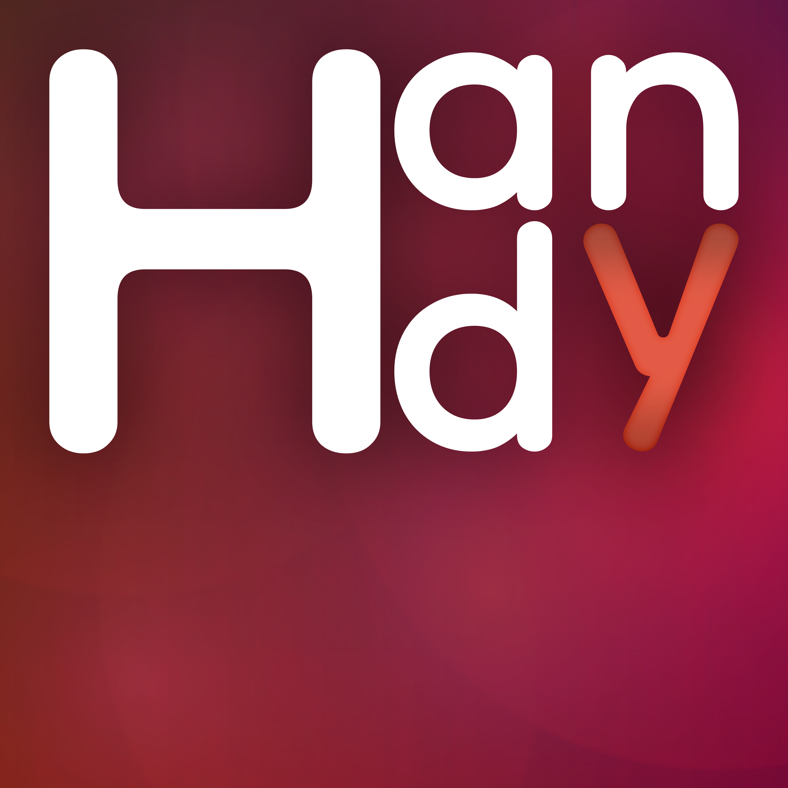
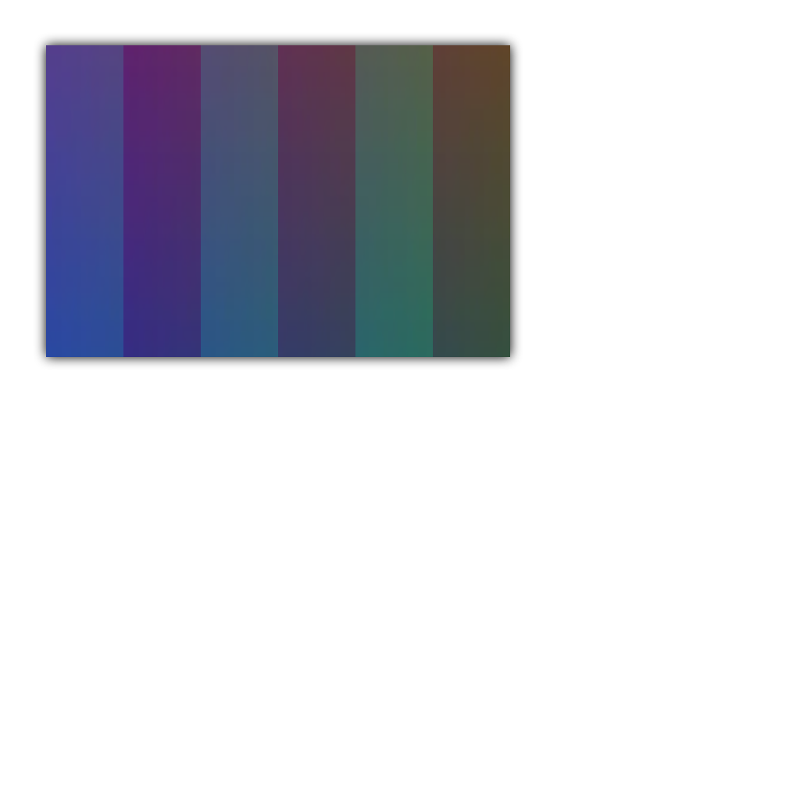
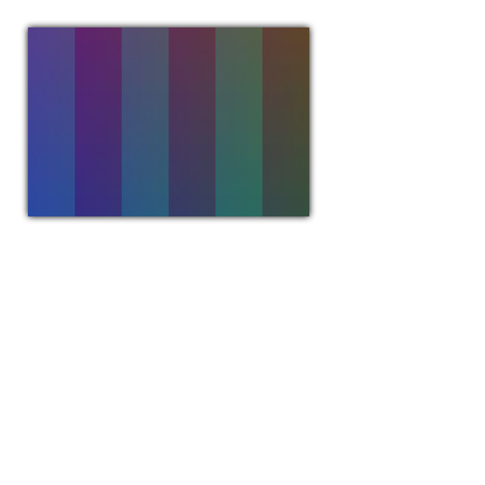

# HandyUI Branding

## v2.x.x Branding

### Logo _(v2.x.x)_
{ width="200" }

!!! info "Info"
    The HandyUI v2.x.x Logo's resolution is 4000x4000. (4K)

### Small Logo _(v2.x.x)_
{ width="200" }

!!! info "Info"
    The HandyUI v2.x.x Small Logo's resolution is 1000x1000. (1K)

### Banner _(v2.x.x)_
{ width="450" }

!!! info "Info"
    The HandyUI v2.x.x Logo's resolution is 2298x856.

## v1.x.x Branding

### Logo _(v1.x.x)_
{ width="200" }

!!! info "Info"
    The HandyUI v1.x.x Logo's resolution is 1024x1024. (1K)
    
### Transparent Logo _(v1.x.x)_
{ width="200" }

!!! info "Info"
    The HandyUI v1.x.x Transparent Logo's resolution is 1024x1024. (1K)

### Small Logo _(v1.x.x)_
{ width="200" }

!!! info "Info"
    The HandyUI v1.x.x Small Logo is only available in `.ico` format.
    The HandyUI v1.x.x Small Logo's resolution is 256x256.

### Small Transparent Logo _(v1.x.x)_
{ width="200" }

!!! info "Info"
    The HandyUI v1.x.x Small Transparent Logo is only available in `.ico` format.
    The HandyUI v1.x.x Small Transparent Logo's resolution is 256x256.

!!! hint ""
    There is 2 other branding assets for HandyUI v1.x.x.
    They are these files:
    `HandyUI-BigIcon.ico` and `HandyUI-BigIcon-T.ico`
    Which are the regular HandyUI v1.x.x logo but theyre 256x256 and theyre in `.ico` format.