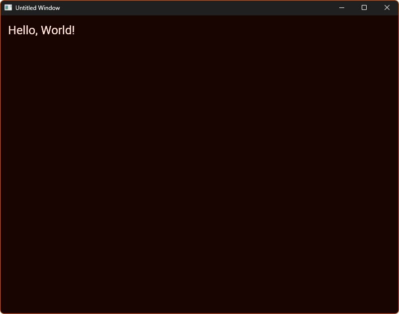

# Getting started with HandyUI

## Quickstart

!!! note "A quick heads-up"
    All code examples in this page use the C# 9 feature, **Top-level Statements**.

Getting started with HandyUI also includes creating a testing window.

!!! warning "Important warning"
    In modern versions of HandyUI *(v4.x+)* you can't create multiple windows anymore. This might change across adapters, but it is valid for the [Silk\.NET adapter](https://www.nuget.org/packages/HandyUI.SilkNet/) provided by me.

## Creating a window

```csharp linenums="1"
using HandyUI.Controls.Controls;
using HandyUI.SilkNet.Data;
using HandyUI.SilkNet.Helper;

var (window, renderer) = WindowHelper.CreateWindowAndGetRenderer(WindowConfiguration.Default);

new Label()
    .WithText("Hello, World!")
    .WithFontSize(24)
    .WithLocation(15, 15)
    .WithAddToRenderer(renderer);

await window.RunAsync();
```

Here's the result of running the piece of code given above:

