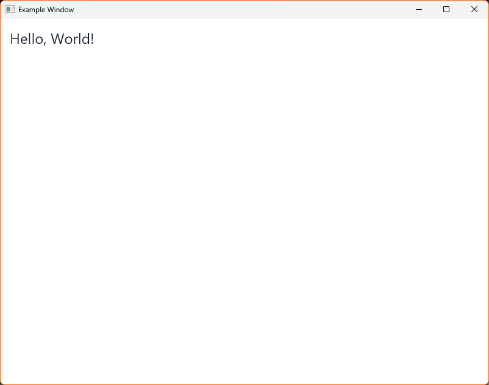
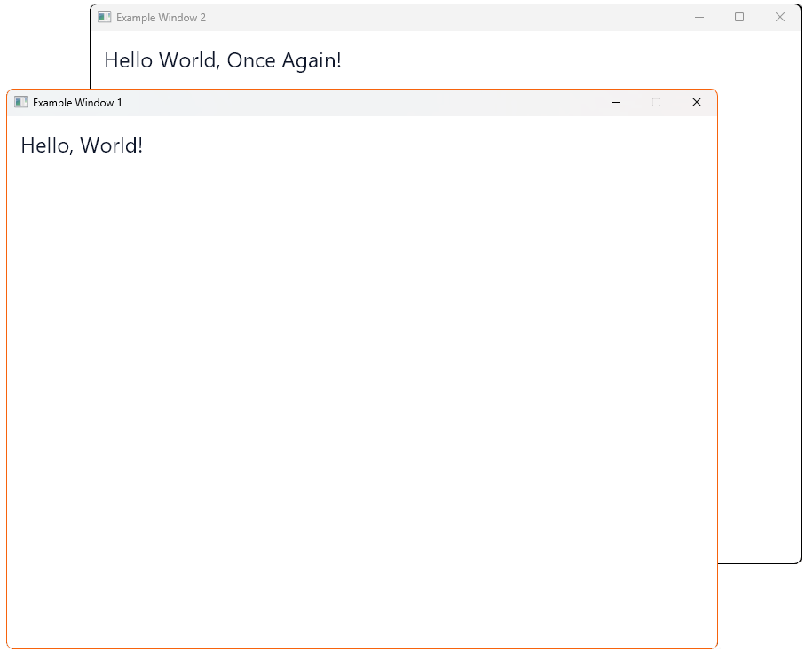
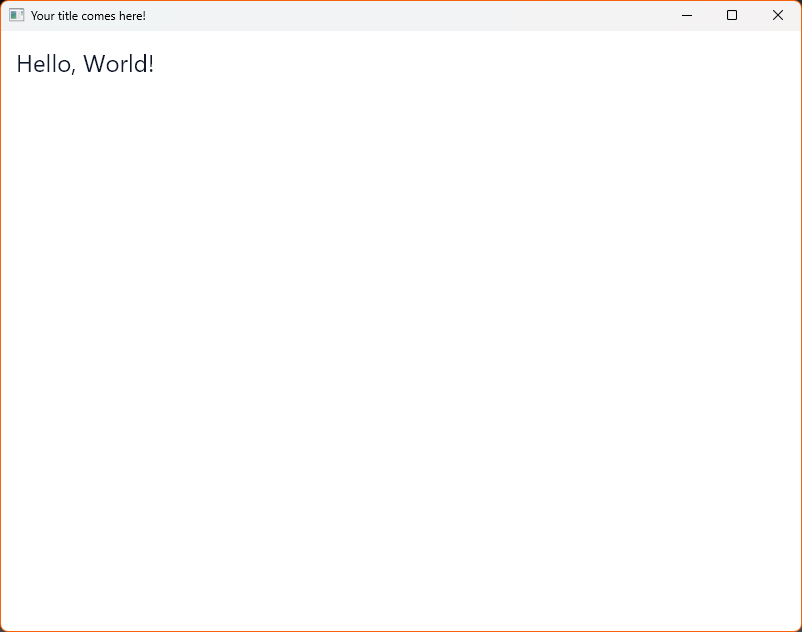

# Getting started with HandyUI

## Quickstart

!!! note "A quick heads-up"
    All code examples in this page use the C# 9 feature **Top-level Statements**.

Getting started with HandyUI also includes creating a testing window.

You have two options:

* Create **one** window

    _or_

* Create **multiple** windows

=== "Creating a single window"

    ### You can create a window just like this:

    ```csharp linenums="1"
    using HandyUI.Controls;
    using HandyUI.SilkNet.Classes.Helper;
    using HandyUI.SilkNet.Classes.Structs;

    var (window, renderer) = WindowHelper.CreateWindowAndGetRenderer(WindowConfiguration.Default);

    new TextLabel()
        .WithText("Hello, World!")
        .WithTextSize(24)
        .WithLocation(15, 15)
        .WithAddToRenderer(renderer);

    await window.RunAsync();
    ```

    Here's the result of running the piece of code given above:

    

=== "Creating multiple windows"

    ### You can also create multiple windows at the same time.

    ```csharp linenums="1"
    using HandyUI.Controls;
    using HandyUI.SilkNet.Classes.Helper;
    using HandyUI.SilkNet.Classes.Structs;

    var (window1, renderer1) = WindowHelper.CreateWindowAndGetRenderer(WindowConfiguration.Default with { Title = "Window 1" });
    var (window2, renderer2) = WindowHelper.CreateWindowAndGetRenderer(WindowConfiguration.Default with { Title = "Window 2" });

    new TextLabel()
        .WithText("Hello, World!")
        .WithTextSize(24)
        .WithLocation(15, 15)
        .WithAddToRenderer(renderer1);

    new TextLabel()
        .WithText("Hello World, Once Again!")
        .WithTextSize(24)
        .WithLocation(15, 15)
        .WithAddToRenderer(renderer2);

    await Task.WhenAll(window1.RunAsync(), window2.RunAsync());
    ```

    Here's the result of running the piece of code given above:

    

## Adding a title to a window

### There are two ways to add a title to a window:
* On Creation
* On Runtime

=== "On Creation"

    ```csharp linenums="1"
    using HandyUI.Controls;
    using HandyUI.SilkNet.Classes.Helper;
    using HandyUI.SilkNet.Classes.Structs;

    var configuration = WindowConfiguration.Default with { Title = "Your title comes here!" };
    var (window, renderer) = WindowHelper.CreateWindowAndGetRenderer(configuration);

    new TextLabel()
        .WithText("Hello, World!")
        .WithTextSize(24)
        .WithLocation(15, 15)
        .WithAddToRenderer(renderer);

    await window.RunAsync();
    ```

=== "On Runtime"

    !!! info "Just one property away"
        You can just modify the _"Title"_ property of your window object.

Here's the result of modifying the title of the window:

