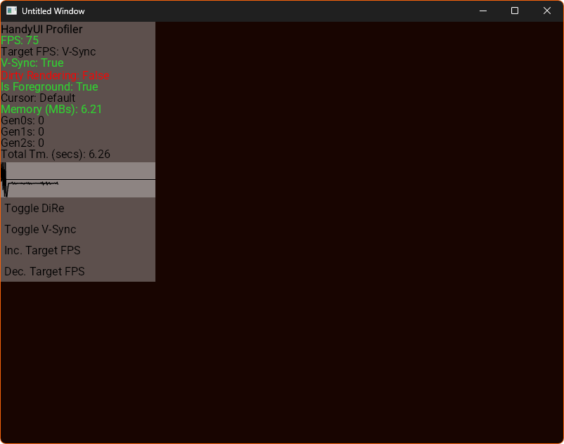

# Debugging a HandyUI app

You can debug a HandyUI app in three ways:

* Using a proper debugger and compiling in Debug mode. ***(an example would be the VS2026 debugger.)***

**or**

* Using the built-in profiler for simpler debugging.

**or**

* Using both methods ***(recommended)***

# Using a proper debugger

You don't have to go through any hoops in order to debug your HandyUI app.

HandyUI most of the time **works without any issues** in debugging environments.

!!! tip "Recommendations for your debugger"
    I **heavily recommend** that you enable **Just My Code** in your debugger settings so that you dont have to step through the internal HandyUI library code when you are debugging a app that uses HandyUI.

# Using the built-in profiler

!!! warning "Prerequisites"
    You will need to either compile your app in Debug mode or enable the profiler via doing `renderer.UseProfiler = true` in code before compiling.

!!! info "Opening the profiler"
    To open the profiler on a HandyUI app **that has the profiler enabled**, you can press `Ctrl+Shift+G`.

Here's how the profiler looks:

## What you can do with the HandyUI profiler

* You can see the current app **rendering FPS** and **target FPS**.
* You can see whether **V-Sync** and **dirty rendering** *(AKA DiRe internally.)* is turned on.
* You can see whether the app is currently focused or not.
* You can see what cursor is currently being shown by controls.
* You can see the app **managed memory usage**.
* You can see the total **generation 0&#47;1&#47;2 GC** amounts.
* You can see the app runtime length.
* You can spot frame timing issues using the **frametime graph**.
* You can toggle **dirty rendering** *(AKA DiRe internally.)*, and **V-Sync** on and off.
* You can **increase/decrease** the app's **target FPS**.

# Using both methods

The Recommended Debugging Workflow:

* **1:** Run your app and press `Ctrl+Shift+G` to spot performance bottlenecks or stuttering frames using the profiler.
* **2:** Once you identify that a specific view or component is causing a frame spike, switch to your IDE debugger.
* **3:** Set a conditional breakpoint inside that component's logic to isolate the root cause and inspect why the state update or render cycle took longer than expected.